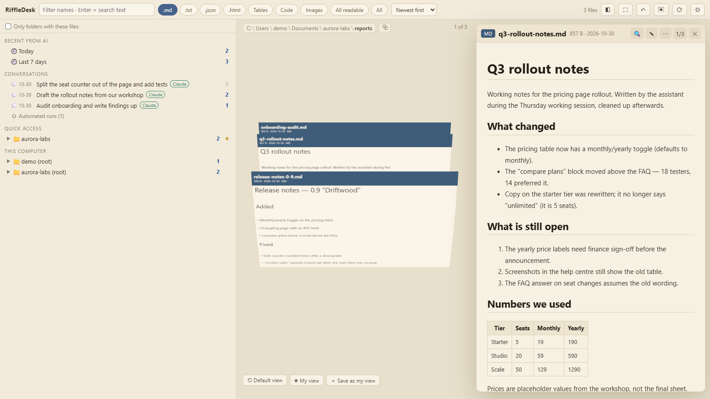
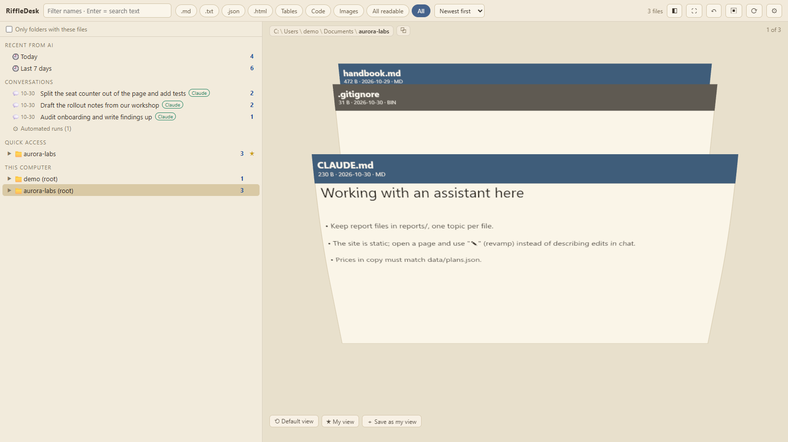
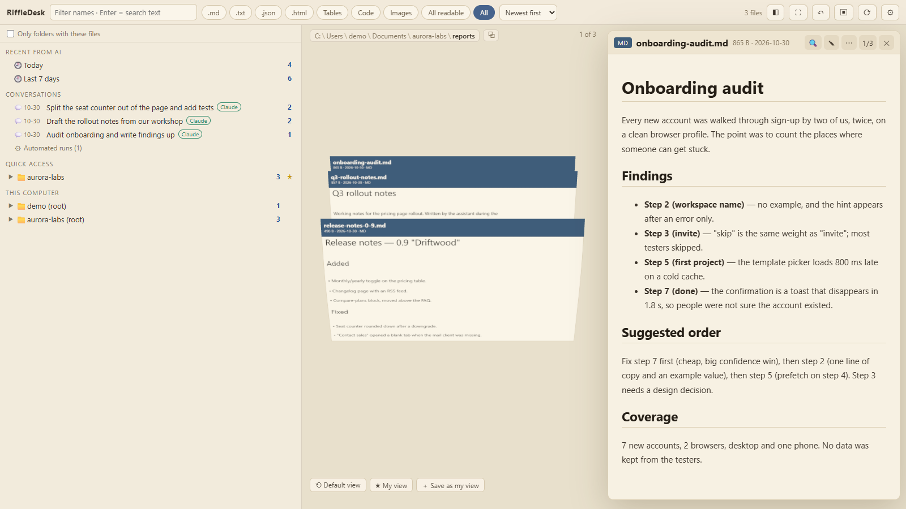
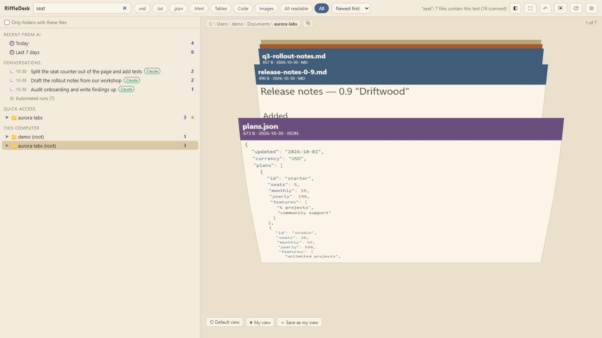
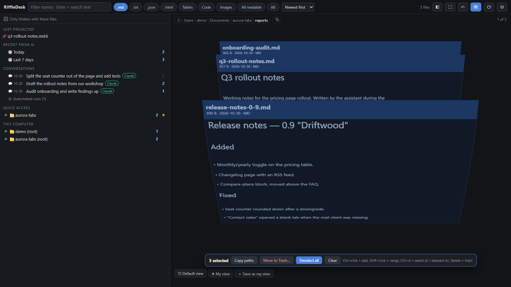
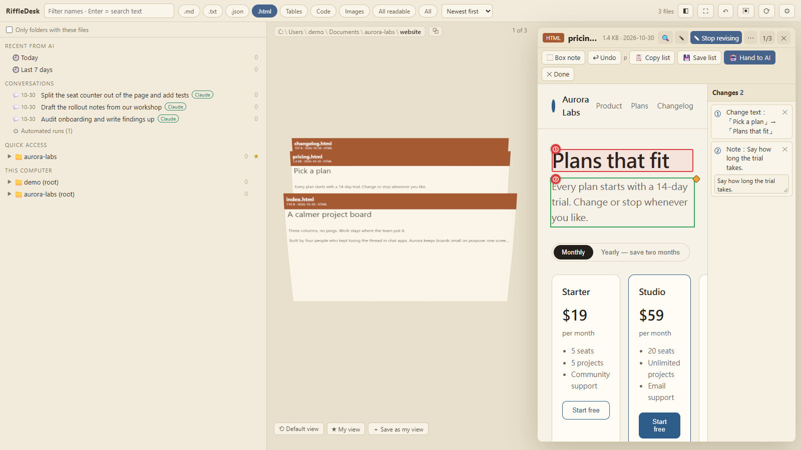
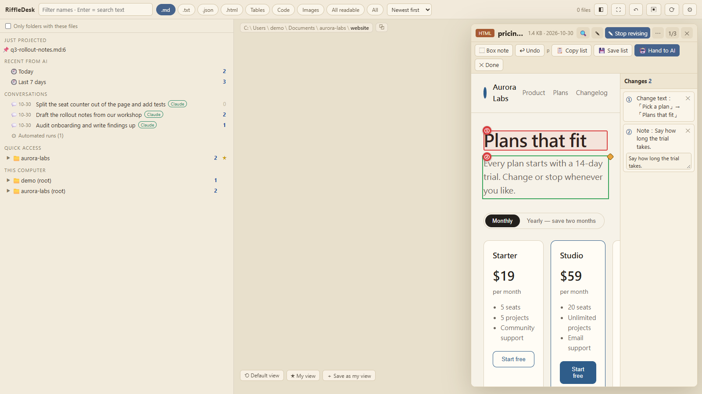

# RiffleDesk

**A local, read-mostly file browser that makes a folder feel like a riffle of cards — so the files an AI just wrote for you are easy to find, read and hand back.**

<p align="center"></p>

繁體中文版：[README.zh-TW.md](README.zh-TW.md)

The demo above runs entirely on invented data (`scripts/demo/make-demo.mjs`) — a fictional four-person studio and their pricing-page rework. Nothing in it is a real file, path, drive or conversation.

## Why this exists

Working with a coding assistant means files appear on your disk that you did not type: notes, drafts, patched source, a report you asked for. Then the interesting part — reading them, judging them, editing them — happens in a terminal or in a chat transcript, both of which are bad at showing a document.

RiffleDesk is the missing surface for that exchange:

- **Finding what the AI gave you.** A folder of 60 freshly written files has no order. The card stack does: newest first, thumbnails readable at a glance, full-text search over everything ever written under a folder. There is a "recent from AI" list built from your own local transcripts, so "the file it wrote ten minutes ago" is one click, not a `find` command.
- **The AI pushing a file at you.** `riffledesk open report.md` from the agent's shell pops the file up in every open tab, scrolled to the line it means. It never steals the screen: a background tab holds it, rings once, and shows it when you come back.
- **You pushing back.** In revamp mode you point at a rendered HTML page and say "this heading is wrong, make the trial length explicit" — text changes, notes, numbered — then press *hand to AI*. That writes a list next to the page, the agent picks it up with `riffledesk wait`, edits, and re-opens the result.

<p align="center"></p>

## Features

**Browsing.** Left column is a folder tree; the middle is a three.js stack of upright cards with rendered thumbnails; hovering pushes neighbours aside like a hand riffling paper, clicking flies the card into a real-DOM reader on the right. Wheel or drag scrolls a virtual reel over arbitrarily large folders. Type filters (`.md`, code, tables, HTML, images…) and a folder-only-with-these-files switch narrow the stack; `All` shows bins too.

<p align="center"></p>

**Reading.** Markdown renders (sanitised), HTML renders in a sandboxed iframe or as highlighted source, JSON prettifies, CSV/TSV/XLSX become tables, PPTX decks become scaled slide cards (text boxes and pictures at their slide positions), images and PDFs open in place. Highlighting and line numbers for code, eight colour themes, a wrap toggle, and find-in-reader with next/previous/count-all.

<p align="center"></p>

**Searching.** Full-text, recursive, over file names *and* contents of text-like files, backed by a persistent index (`node:sqlite` FTS5 trigram) that is crawled incrementally in a background worker thread. Short queries fall back to file names; results are re-verified against the file text so nothing stale comes back.

<p align="center"></p>

**Editing.** Click ✎ (or `Ctrl+E`) to edit the file you are reading, `Ctrl+S` to save. Before writing, the reader compares the disk version: if an AI rewrote the file meanwhile, you get a diff dialog instead of a silent overwrite. Renames, deletes and saves all undo with `Ctrl+Z` (deletes go to the OS trash, never a hard delete).

**Multi-select.** `Ctrl`-click cards to select, then rename, trash, copy paths or push the selection as one batch; a failed item keeps the rest alive.

<p align="center"></p>

**Revamp mode (HTML).** Point, describe, number. The page is served through a sandboxed iframe with an injected agent; every change becomes an entry in `<name>.changes.json` next to the file, which the AI reads with `riffledesk changes`. See the [API doc](docs/API.md#revamp-mode-the-user-pushes-a-change-list-at-the-ai).

<p align="center"></p>

**Projection.** `POST /api/project` (what the CLI calls) opens a file in every tab, optionally at a line. Background tabs hold it and raise one notification per burst.

<p align="center"></p>

**Piles.** `riffledesk show a.md b.md --title "…"` hands over a whole shortlist as one stack — only those cards, nothing else from the folders they live in. It notifies rather than switching; the left column keeps the recent piles and `/?pile=<id>` reopens one. `riffledesk search … --json | riffledesk show` works too.

AI handoff piles always show every delivered file, regardless of the folder type filter. The type control says “All files in this pile”; leaving the pile restores your folder filter. A pile's count shows files that still exist; only an empty pile's count is muted.

**Also:** AI-conversation lists ("which conversation wrote this file?"), pinned folders, a secret scan that flags files containing what looks like an API key, and an idle render loop that stops entirely when nothing moves.

## Install

```sh
npx riffledesk
```

Node ≥ 22.5 (the index needs `node:sqlite`; older Node runs, with live-scan search only). Zero runtime dependencies. Or from a clone: `npm install && npm start`. Windows: `start.bat`; macOS/Linux: `start.sh`.

It browses by default and only writes when you ask it to: save, rename, trash — every write is an explicit click, and trash is recoverable.

The app binds `127.0.0.1` only and opens at <http://127.0.0.1:5177/>. Change the port with `PORT`, a port argument, or `riffledesk --port 5180`; `--no-open` skips the browser. Launching again reuses the server on that port.

The launcher exits after starting a windowless background server. Closing its terminal or coding assistant leaves RiffleDesk running. In **Settings → RiffleDesk**, see the version, restart, or stop the server. These actions affect all tabs connected to that server. After stopping, run RiffleDesk again to resume. No login service or automatic startup is installed.

From a shell: `riffledesk status`, `riffledesk restart`, and `riffledesk stop` (each accepts `--port N`). Updating the npm package does not replace an already running server: restart it afterward. A server older than 0.3.0 must be stopped manually once. Developers can use `npm run dev` or `riffledesk --foreground` to keep the server attached to a terminal with Ctrl+C to stop. On Windows, use `riffledesk.cmd` in Git Bash if antivirus blocks the POSIX shim.

## Command line for AI agents

The launcher is also the agent-side CLI — this is the half that makes the tool useful to an assistant:

```sh
riffledesk open report.md --line 42     # push a file into every open tab
riffledesk show a.md b.md --title "Retry budget"   # hand over a shortlist as one stack
riffledesk search "retry budget" --in ~/notes --ext .md --json | riffledesk show
riffledesk changes page.html            # read the user's revamp list
riffledesk wait page.html               # block until the user hands one over
riffledesk --help
```

`open` POSTs to `/api/project` with the header `X-RiffleDesk-CLI: 1` (a browser's cross-site POST cannot forge it) and reports how many tabs took the file; with none connected, or on a server that predates the endpoint, it opens `/?open=<path>` in the default browser instead. Both subcommands probe the local port first and start a detached, windowless server when nothing answers. Output is English so scripts can parse it; `search` exits 1 when nothing matched, 2 on bad usage.

A ready-made skill that teaches an agent this loop lives in [`skills/riffledesk/`](skills/riffledesk/). The full endpoint reference is in [docs/API.md](docs/API.md).

### Opt-in Stop-hook reminder (Claude Code)

Agents sometimes finish a turn with freshly written deliverables (reports, pages, sheets) they never handed over. The CLI ships a Stop hook that nudges them once in exactly that case:

```sh
riffledesk hook install      # merge a Stop hook into ~/.claude/settings.json (.bak written first)
riffledesk hook status       # installed? (exit 0 yes / 1 no)
riffledesk hook uninstall    # remove exactly our entry, leave other hooks alone
```

When the agent stops, the hook scans the tail of the session transcript; if a Write/Edit created a deliverable file (`.md .html .svg .pdf .csv .png .jpg .docx .xlsx .pptx`…) and no `riffledesk open`/`show` ran after the last user message, the agent is reminded with the exact command. It never loops, watches nothing continuously, and any error exits silently so it can never block a session. Nothing else in the settings file is touched; an invalid-JSON file is refused (exit 2), never overwritten.

Markdown uses a calm reading layout without rewriting the source. HTML can mix
prose, diagrams and an interactive three.js figure inside the document; the user
explicitly enables page code. See [delivery capabilities and optional examples](skills/riffledesk/DELIVERABLES.md).
Agents can choose their own format; no additional skill or template is required.

The sidebar groups can be collapsed. Conversations use the tool's saved title or summary when available; hover to see the first prompt, or use the info button to copy the session ID and locate the original transcript. Browser-tab mode keeps its cards and position when new deliveries arrive or a connection check fails; reconnecting does not switch you back to files.
The toolbar's **Type** menu supports multiple file types with ordinary clicks.
**HTML / interactive 3D** includes HTML pages; standalone JavaScript stays under Code.

## Privacy

- **Loopback only.** The server listens on `127.0.0.1`, replies only to loopback `Host` headers, rejects cross-site API calls (`Sec-Fetch-Site` + `Origin` on every write), and sends `Cross-Origin-Resource-Policy: same-origin`, so a random web page cannot read your files through it.
- **No telemetry, no cloud.** Nothing leaves the machine. (three.js, marked, DOMPurify and SheetJS load from a CDN with pinned versions and SRI, so the page itself needs network; highlight.js is vendored and works offline.)
- **The transcripts it reads.** To build the "recent from AI" and conversation lists, the server reads *locally* the write/edit records of the supported tools (Claude Code, Codex, Gemini CLI, Cline / Roo Code / Kilo Code, Pi, Grok Build — locations in the table below). Only file paths, titles and timestamps are extracted, nothing is uploaded, and the parse is cached by size+mtime.
- **Turning it off.** `convoRoots: []` in `config.json` disables transcript scanning entirely; `convoRoots: [{kind, dir}]` points it at other directories. Delete `index.db*` to wipe every path name the index holds.
- **Browsing scope** defaults to all local drives plus your home documents. That is wide on purpose; `config.json` `roots` narrows it.

## Which AI tools are supported

The conversation sidebar reads the tools' own record files — **the terminal or IDE you launched them from does not matter**, only where each tool writes its history.

| Tool | Supported | Records |
|---|---|---|
| Claude Code (CLI, VS Code & JetBrains extensions, desktop App's Code tab) | ✅ | `~/.claude/projects/*/*.jsonl` |
| Codex (CLI, desktop App, VS Code extension) | ✅ | `~/.codex*/sessions/**/rollout-*.jsonl` |
| Gemini CLI | ✅ | `~/.gemini/tmp/<project>/chats/**` (`GEMINI_CLI_HOME` relocates the base) |
| Cline / Roo Code / Kilo Code (VS Code extensions, legacy layout) | ✅ | VS Code globalStorage `*/tasks/<taskId>/api_conversation_history.json` |
| Pi (badlogic/pi-mono) | ✅ | `~/.pi/agent/sessions/**/*.jsonl` (`PI_CODING_AGENT_SESSION_DIR` relocates) |
| Grok Build (xAI's official coding agent) | ✅ | `~/.grok/sessions/*/*/updates.jsonl` (`GROK_HOME` relocates) |
| Cursor, Windsurf, GitHub Copilot, opencode (current), Kilo Code (2026 rewrite), superagent-ai/grok-cli | ❌ | SQLite / private formats — not parsed |
| Aider | ❌ | per-project `.aider.chat.history.md`; covered by "Recently modified (source unknown)" instead |

Note: Cursor and Windsurf's own histories are not parsed, but Cline-family extensions installed inside them are still scanned (their `globalStorage` is on the scan list).

The full audit — every checked location, format, source link and confidence — is in [docs/ai-sources.md](docs/ai-sources.md). For an unsupported tool, either have the assistant run `riffledesk open <file>` / `riffledesk show …`, or use the sidebar's **最近改動（不確定是誰改的）(Recently modified, source unknown)** row: files changed in the last 7 days inside marker-project folders (AGENTS.md / CLAUDE.md / GEMINI.md / .claude / .cursor / .git, or >=5 Markdown files in one folder), minus everything a supported AI conversation provably wrote. It is answered from the existing index (mtime), never another disk scan, and it needs the index running.

## Limits

- **A cloud assistant that only sees screenshots cannot reach the server.** The CLI works for an agent with a shell on the same machine. For a chat assistant running elsewhere, this is a browser you drive yourself, not a remote endpoint.
- Read-only by default; the four write endpoints (reveal, open, rename, trash) plus save and pin are the only things that touch disk, and trash never hard-deletes.
- Text editing is UTF-8 only, ≤ 5 MB, text kinds only. Non-UTF-8 (Big5, UTF-16), binaries and XLSX are view-only. The undo stack lives in memory, 20 steps, gone on restart. Trash-undo is Windows-only.
- XLSX shows the first sheet; PDF is an embed only. PPTX rendering is text-and-picture level only (no masters/layouts, SmartArt or animations; old binary .ppt opens in the system app instead), and full-text indexing does not reach inside PPTX files — their names are still searchable.
- The find box inside a *running* HTML page cannot reach its DOM — switch to the safe preview or the source.
- Very large folders (System32-scale) return megabytes of JSON on first listing; a directory cache softens repeats.
- The front-end search box filters file names in the current folder; recursive full-text search is the `/api/search` path.

## Compatibility

Chromium, Firefox and Safari — the last two latest versions. The card stack needs WebGL; on a machine without it, RiffleDesk shows a notice card instead of the stack (the tree, search, reading and editing stay usable, and files still open). If the context is lost mid-session — a graphics driver reset — the same notice covers the card column and offers a reload. There is no 2D fallback, so a stale `?flat=1` bookmark still works but changes nothing. The server is POSIX and Windows; trash-undo and the file-manager reveal are Windows-specific.

## Platform notes

- **What is browsable without extra config.** Windows: every fixed drive letter (`C:\`, `D:\`, …). macOS: your home folder plus external volumes under `/Volumes` (the system-root alias *Macintosh HD → /* and the data volume *Macintosh HD - Data → /System/Volumes/Data* are excluded on purpose, so system folders are not silently browsable). Linux/WSL: your home folder plus `/mnt/*` and `/media/<user>/*` (`/run/media/<user>/*` for udisks2 desktops; every `/media/*` entry when your user cannot be resolved). Anything outside that list — say `/opt/data` — is one line away in `config.json` (`roots`, or drag in with `pinned`).
- **three.js loads from a CDN** (`cdn.jsdelivr.net` import map), so the first page load needs network access; everything else is fully local.
- **Running the tests on macOS.** Unit tests: `node --test --test-concurrency=1 "tests/*.test.mjs"` (no native deps; ports 5179 and 5193–5196). The browser e2e scripts find Chrome on their own via `tests/chrome-path.mjs` (Chrome/Chromium/Edge under `/Applications`, or a playwright-bundled Chromium for extension tests); point `CHROME_PATH` at another executable to override, e.g. `CHROME_PATH="/Applications/Google Chrome.app/Contents/MacOS/Google Chrome" node tests/e2e.mjs`.

## Configuration

`config.json` is created on first start (git-ignored; `config.example.json` is the blank template). Keys: `roots` (extra browsable roots), `pinned` (starred folders, written back by the UI), `indexSkipDirs`, `indexMaxMB`, `indexContent`, `secretScan`, `secretScanSkipDirs`, `convoRoots`, `browser`. Point `RIFFLEDESK_CONFIG` at another file to isolate a profile.

## Development

```sh
npm test              # server-level (node --test, port 5179)
npm run test:e2e      # full browser acceptance (playwright, 5178)
npm run test:regress  # regression sweep, self-built fixtures
npm run test:edit     # editor / find / conflict (5184)
npm run test:project  # projection (5188)
npm run test:select   # card selection (5190)
npm run demo:make     # build the invented demo dataset
npm run demo:record   # re-record docs/media from it
```

The browser tests drive an installed Chrome through `playwright-core` on ports 5178+ and build their own fixtures in the temp directory, so they never touch your real `config.json` or index.

Unit tests that serve a temp fixture declare it as a "drive" through the test-only `RIFFLEDESK_TEST_DRIVES` variable (path-delimiter separated; honoured by `collectDrives()` only under `NODE_ENV=test`), because the temp directory is outside the POSIX browse scope. Set it on a Windows run to replay the narrower POSIX scope: `NODE_ENV=test RIFFLEDESK_TEST_DRIVES="D:\nonexistent" node --test --test-concurrency=1 "tests/*.test.mjs"`.

## Licence

MIT — see [LICENSE](LICENSE).
