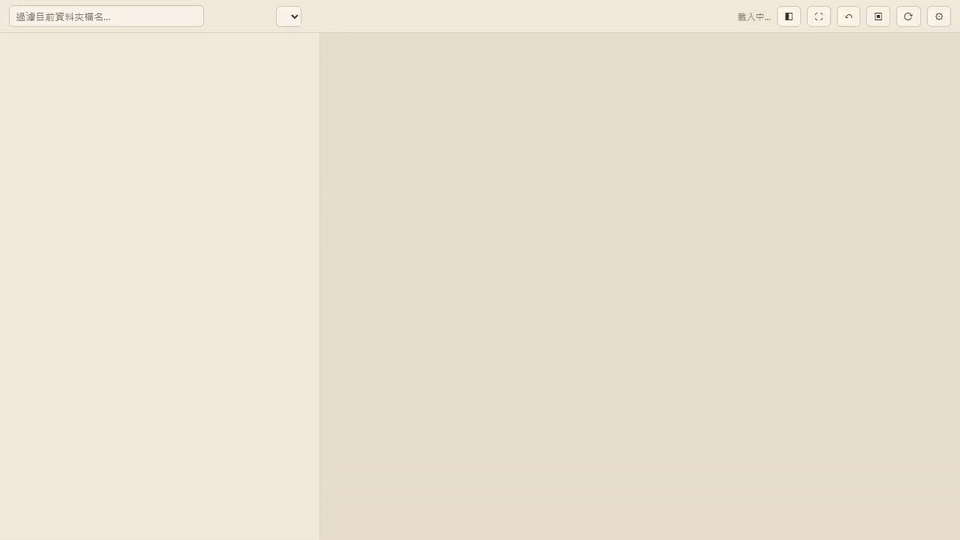
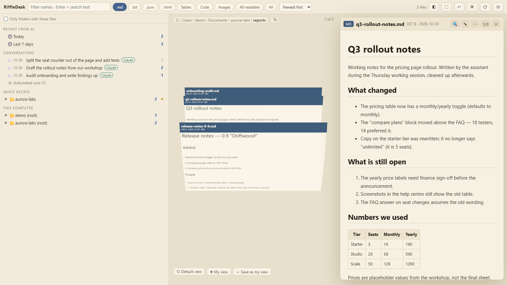
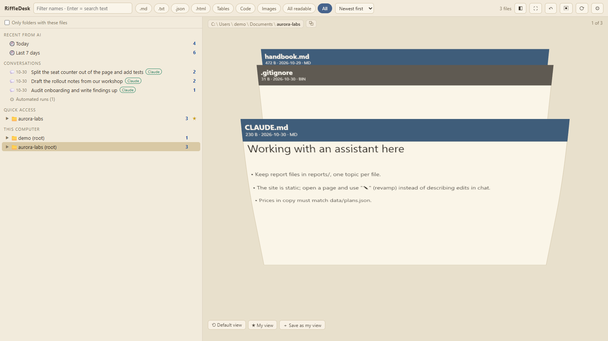
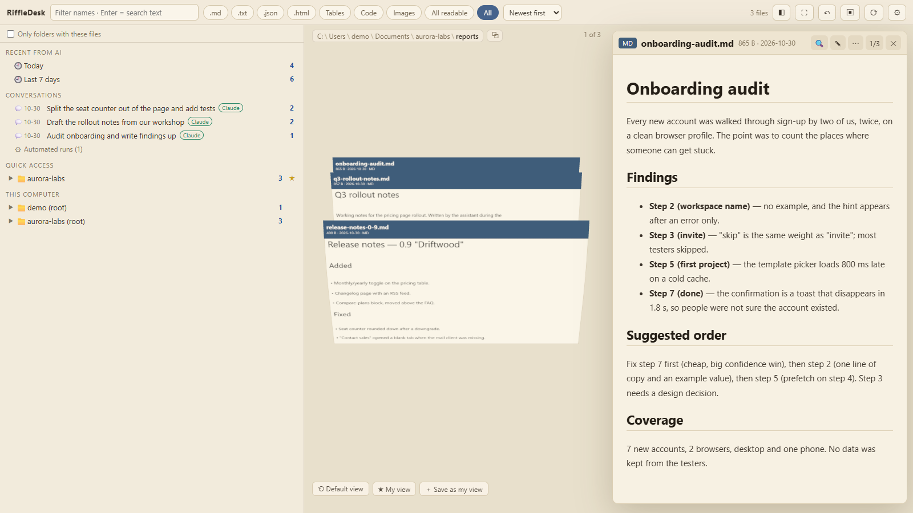
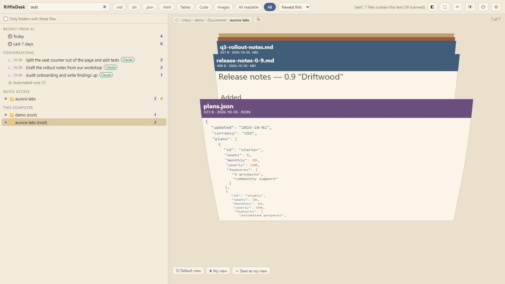
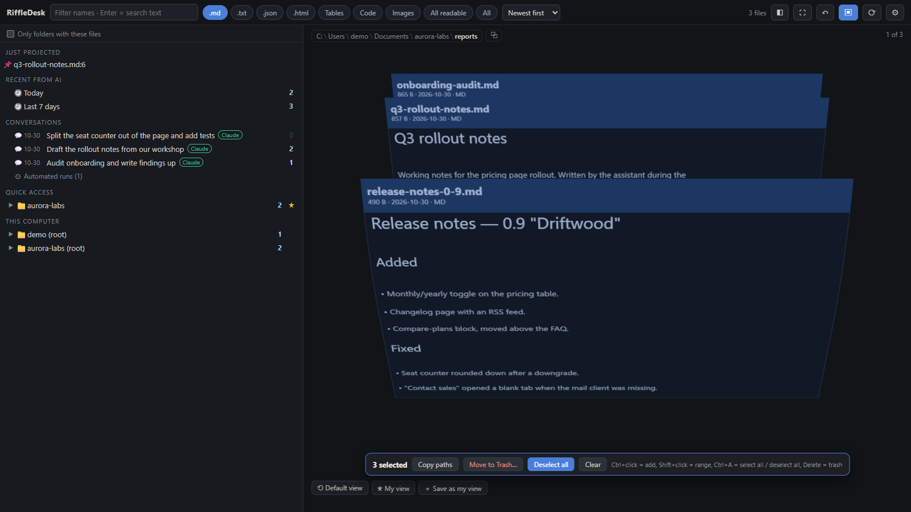
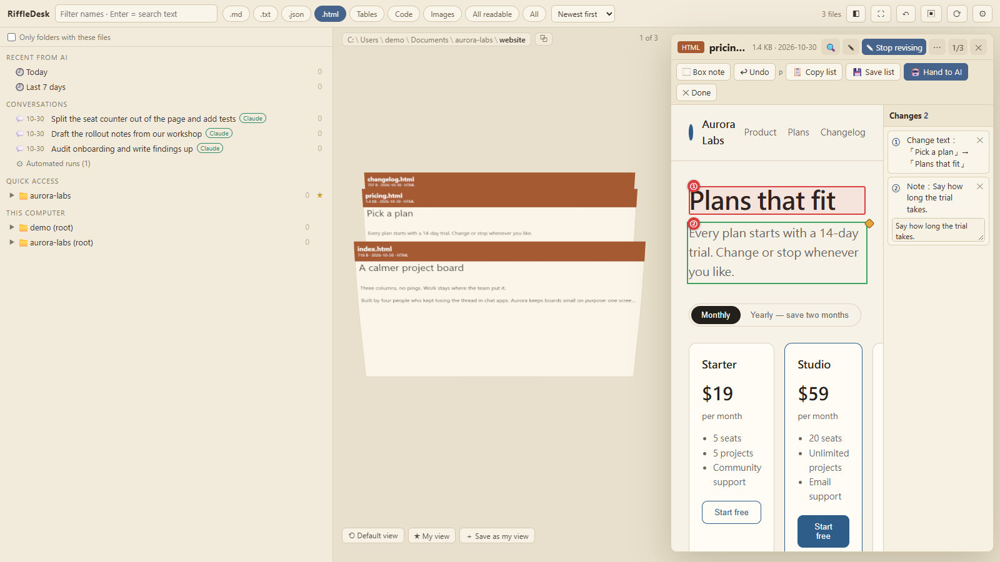
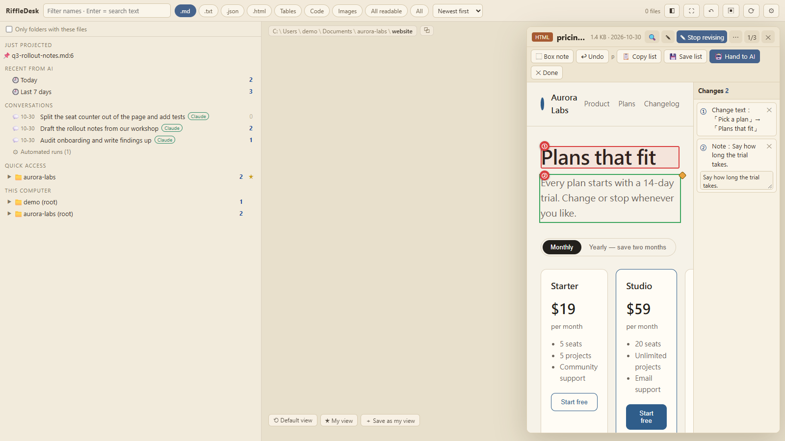

# RiffleDesk

**本機用、以瀏覽為主的檔案瀏覽器：把一個資料夾翻成一疊卡片，讓 AI 剛幫你寫的檔一看就找得到、讀得到、也改得回去。**

<p align="center"></p>

English: [README.md](README.md)

上面的示範全部跑在捏造的資料上（`scripts/demo/make-demo.mjs` 生的，一個虛構的四人工作室和他們的定價頁改版）。畫面裡沒有真實檔案、路徑、磁碟或對話。

## 為什麼有這個東西

跟 AI 一起做事，磁碟上會冒出你沒打過的字：筆記、草稿、改過的程式、你叫他寫的報告。接著最有趣的部分——讀它、判斷它、改它——發生在終端機或對話視窗，而那兩者都很不會呈現一份文件。

RiffleDesk 就是補這個洞的介面：

- **找出 AI 給你的檔。** 一個剛被寫進 60 個檔的資料夾沒有順序，卡片堆有：最新在前、縮圖一眼可讀、整個資料夾底下所有寫過的字都全文搜得到。還有一份「AI 最近給的」清單，來源是你自己本機的對話紀錄，所以「它十分鐘前寫的那個」是一次點擊，不是一行 `find`。
- **AI 把檔推到你面前。** agent 的 shell 裡一句 `riffledesk open report.md`，每個開著的分頁都會跳出來並捲到它指的行。但**它不搶畫面**：背景分頁會先壓著、響一聲，等你回來才顯示。
- **你推回去。** 改版模式裡，你直接在渲染出來的 HTML 上點「這個標題不對，把試用期長度寫清楚」，文字改了、備註加了、還編了號，然後按「交給 AI」。頁面旁就寫出一份清單，agent 用 `riffledesk wait` 接走、照著改，再把結果開出來給你看。

<p align="center"></p>

## 功能

**瀏覽。** 左欄是資料夾樹，中間是 three.js 立起來的卡片堆（卡片有畫好的縮圖），游標掃過會像手撥紙一樣把鄰卡撥開，點一下就飛到右邊的閱讀面板。滾輪或拖曳在超大資料夾上做虛擬捲動。類型 chips（`.md`、程式碼、表格、HTML、圖片…）和「只看有這些檔的資料夾」把卡片堆收窄，`All` 連二進位檔都進來。

<p align="center"></p>

**閱讀。** markdown 渲染（消毒過）、HTML 用沙箱 iframe 或上色原始碼、JSON 美化、CSV/TSV/XLSX 變表格、圖片與 PDF 就地開。程式碼有上色和行號、八套配色、換行開關，閱讀區可以查找並上一個／下一個／全部標亮。

<p align="center"></p>

**搜尋。** 全文、遞迴，檔名和文字類檔的內容都搜，背後是常駐索引（`node:sqlite` FTS5 trigram），由背景 worker thread 增量爬。短查詢退回只搜檔名；結果會回讀檔案驗證，不給過期的東西。

<p align="center"></p>

**編輯。** 點 ✎（或 `Ctrl+E`）編輯正在讀的檔，`Ctrl+S` 存檔。寫回之前會比對磁碟版本：AI 這期間改過就跳差異對話框，不默默蓋掉。改名、刪除、存檔都能 `Ctrl+Z` 復原（刪除是進資源回收筒，絕不硬刪）。

**多選。** `Ctrl` 點卡片選取，然後批次改名、刪除、複製路徑或整批推給 AI；單項失敗不會拖垮其他項。

<p align="center"></p>

**改版模式（HTML）。** 點、描述、編號。頁面在沙箱 iframe 裡附帶一支注入的 agent，每一筆改動都變成檔案旁的 `<檔名>.changes.json`，AI 用 `riffledesk changes` 讀。細節見 [API 文件](docs/API.md#revamp-mode-the-user-pushes-a-change-list-at-the-ai)。

<p align="center"></p>

**投影。** `POST /api/project`（CLI 打的就是這支）把一個檔開進每個分頁，可指定行號。背景分頁會壓著並只發一則通知。

**疊。** `riffledesk show a.md b.md --title "…"` 把一組相關的檔一次交成一疊卡：只有這幾張，同資料夾的其他檔不會冒出來。它只跳通知、不切畫面；左欄留著最近的疊，`/?pile=<id>` 能重開。也可以 `riffledesk search … --json | riffledesk show`。

AI 整理的疊會完整顯示交付檔案，不受資料夾類型篩選影響。類型按鈕會標示「此疊顯示全部」；離開疊後恢復原本的資料夾篩選。疊旁數字表示仍存在的檔案數，只有空疊的數字才反灰。

<p align="center"></p>

**其他：** AI 對話清單（「這檔是哪則對話寫的？」）、釘選資料夾、把疑似金鑰的檔標出來的密鑰掃描，還有沒動作就完全停掉的 idle render loop。

## 安裝

```sh
npx riffledesk
```

Node ≥ 22.5（索引要靠 `node:sqlite`；舊版 Node 可跑但只能即時掃描）。執行期零相依。從 clone 跑：`npm install && npm start`。Windows 用 `start.bat`，macOS/Linux 用 `start.sh`。

預設只是瀏覽，只有你叫它寫才寫：存檔、改名、刪除，每個寫入都是明確的一次點擊，而且刪除進回收筒、救得回來。

伺服器只綁 `127.0.0.1`，開在 <http://127.0.0.1:5177/>。用 `PORT`、埠參數或 `riffledesk --port 5180` 換埠；`--no-open` 不開瀏覽器。重複啟動會沿用同一個埠上的服務。

啟動器開完就會結束，RiffleDesk 留在背景執行；關閉終端或 AI 助手不影響使用。到 **設定 → RiffleDesk** 可看版本、重新啟動或結束服務；這會影響連到該服務的所有分頁。結束後再次開啟 RiffleDesk 即可使用，不會自動設定開機啟動。

命令列也有 `riffledesk status`、`riffledesk restart`、`riffledesk stop`，都接受 `--port N`。更新 npm 套件後要重新啟動服務，已執行的舊程式才會換新版。0.3.0 以前的服務需先手動結束一次。開發時用 `npm run dev` 或 `riffledesk --foreground` 留在終端執行，按 Ctrl+C 結束。Windows 若在 Git Bash 被防毒阻擋，改用 `riffledesk.cmd`。

PowerPoint `.pptx` 可預覽投影片文字與圖片、顯示第一頁縮圖，並在閱讀區查找文字；動畫、SmartArt、母片效果及舊 `.ppt` 不支援，投影片內容也不納入全碟內文搜尋。

## 給 AI agent 的命令列

啟動器同時就是 agent 端的 CLI——這是這個工具對助手有用的另一半：

```sh
riffledesk open report.md --line 42     # 把檔推給所有已開分頁
riffledesk show a.md b.md --title "重試預算"   # 一次交一組檔（一疊）
riffledesk search "retry budget" --in ~/notes --ext .md --json | riffledesk show
riffledesk changes page.html            # 讀使用者的改版清單
riffledesk wait page.html               # 等使用者交過來
riffledesk --help
```

`open` 打 `POST /api/project` 並帶 `X-RiffleDesk-CLI: 1` 標頭（瀏覽器的跨站 POST 偽造不出來），回報推給幾個分頁；沒有分頁、或伺服器舊到沒這支端點時，改用預設瀏覽器開 `/?open=<路徑>`。兩個子命令都會先探測本機埠，沒人回應就背景無頭起一台。輸出全英文方便腳本解析；`search` 沒結果 exit 1、參數錯 exit 2。

教 agent 這套流程的 skill 放在 [`skills/riffledesk/`](skills/riffledesk/)。完整端點清單在 [docs/API.md](docs/API.md)。

### 可選的 Stop 提醒（Claude Code）

agent 有時寫完要交付的檔（報告、網頁、試算表）就直接收尾，忘了給使用者看。CLI 內建一支 Stop hook，專門在這種情況提醒一次：

```sh
riffledesk hook install      # 合併進 ~/.claude/settings.json（先寫 .bak、其他 hook 不動）
riffledesk hook status       # 看有沒有裝（裝了 exit 0、沒裝 exit 1）
riffledesk hook uninstall    # 只移除我們這條
```

agent 收尾時 hook 才跑一次：掃對話紀錄尾巴，如果 Write/Edit 寫了交付型檔案（`.md .html .svg .pdf .csv .png .jpg .docx .xlsx .pptx`…），而且最後一句使用者訊息之後沒跑過 `riffledesk open`／`show`，就用正確指令提醒 agent 補交。不會遞迴觸發、平常完全不跑；任何錯誤都靜默結束，絕不卡住對話。設定檔其他內容一律不動；檔案不是合法 JSON 就拒絕（exit 2），不會覆蓋。

一般 Markdown 會自動套用書頁式閱讀排版，原稿不變。HTML 可以在同一份文件裡混合文字、插圖、圖解與可操作的 three.js 圖；程式由使用者按下執行才啟用。詳見[交付能力與可選範例](skills/riffledesk/DELIVERABLES.md)，不需要另外安裝技能，也不強制 agent 使用模板。

工具列的「類型」選單可直接複選，例如同時顯示 MD 與 TXT，重整後保留選擇。「HTML／互動 3D」包含 HTML 網頁；單獨的 JavaScript 仍屬程式碼。這裡只篩選顯示檔案，不限制 AI 產出格式。

左欄群組可以收合。對話優先顯示工具已儲存的標題或摘要，滑過可看使用者的第一句話，資訊按鈕可複製 Session ID 並找到原始紀錄。網頁模式不會被新交付通知切回檔案；連線檢查失敗時保留卡片與位置，恢復連線也不重載畫面。

## 隱私

- **只走 loopback。** 伺服器聽 `127.0.0.1`，只回 loopback 的 `Host`，跨站 API 呼叫一律拒絕（`Sec-Fetch-Site`＋每個寫入都要 `Origin`），並且每個回應都帶 `Cross-Origin-Resource-Policy: same-origin`——外面的網頁讀不到你的檔。
- **沒有遙測、不上雲。** 什麼都不離開這台機器。（three.js、marked、DOMPurify、SheetJS 從 CDN 載、固定版本＋SRI，所以「頁面本身」需要網路；highlight.js 是內附的，離線可用。）
- **它讀哪些對話紀錄。** 為了做「AI 最近給的」和對話清單，伺服器會在**本機**讀支援清單內各工具的寫檔紀錄（Claude Code、Codex、Gemini CLI、Cline／Roo Code／Kilo Code、Pi、Grok Build——位置見下表）。只抽檔案路徑、標題、時間，不上傳，解析結果按 size+mtime 快取。
- **關掉它。** `config.json` 寫 `convoRoots: []` 就完全不做對話掃描；`convoRoots: [{kind, dir}]` 可指向別的目錄。刪掉 `index.db*` 就清掉索引裡所有路徑名稱。
- **瀏覽範圍**預設是所有本機磁碟加上家目錄文件。這是刻意的寬；`config.json` 的 `roots` 可以收窄。

## 支援哪些 AI 工具

對話側欄讀的是各工具自己寫下的紀錄檔——**跟終端機／IDE 無關，只看 AI 工具的紀錄檔放在哪**。

| 工具 | 支援 | 紀錄位置 |
|---|---|---|
| Claude Code（CLI、VS Code／JetBrains 擴充、桌面 App 的 Code 分頁） | ✅ | `~/.claude/projects/*/*.jsonl` |
| Codex（CLI、桌面 App、VS Code 擴充） | ✅ | `~/.codex*/sessions/**/rollout-*.jsonl` |
| Gemini CLI | ✅ | `~/.gemini/tmp/<專案>/chats/**`（`GEMINI_CLI_HOME` 可換家目錄） |
| Cline／Roo Code／Kilo Code（VS Code 擴充，舊版面） | ✅ | VS Code globalStorage `*/tasks/<taskId>/api_conversation_history.json` |
| Pi（badlogic/pi-mono） | ✅ | `~/.pi/agent/sessions/**/*.jsonl`（`PI_CODING_AGENT_SESSION_DIR` 可換） |
| Grok Build（xAI 官方 coding agent） | ✅ | `~/.grok/sessions/*/*/updates.jsonl`（`GROK_HOME` 可換） |
| Cursor、Windsurf、GitHub Copilot、opencode（現行版）、Kilo Code（2026 改版）、superagent-ai/grok-cli | ❌ | SQLite／私有格式，不解析 |
| Aider | ❌ | 各專案的 `.aider.chat.history.md`；用「最近改動」涵蓋 |

註：Cursor／Windsurf 自身歷史不解析，但裝在它們裡面的 Cline 家族延伸會被掃描（其 globalStorage 在掃描清單內）。

完整調查（每個位置、格式、來源網址、信心）在 [docs/ai-sources.md](docs/ai-sources.md)。不在支援清單的工具：叫 AI 跑 `riffledesk open <檔>`／`riffledesk show …` 把檔案推進來，或用側欄的「**最近改動（不確定是誰改的）**」列——列出標記專案資料夾（有 AGENTS.md／CLAUDE.md／GEMINI.md／.claude／.cursor／.git，或同層 ≥5 個 Markdown）裡最近 7 天改過的檔案，扣掉確定是支援中的 AI 對話寫的。這列直接用既有索引查 mtime，不會再掃磁碟，需要索引在跑才看得到。

## 限制

- **只看得到截圖的雲端助手碰不到這台伺服器。** CLI 要 agent 在同一台機器上有 shell。對跑在別處的聊天助手而言，這是你自己操作的瀏覽器，不是遠端端點。
- 預設唯讀；只有四個寫入端點（reveal／open／rename／trash）加上存檔與釘選會動磁碟，而且刪除只進回收筒。
- 文字編輯只收 UTF-8、≤5MB、文字類。非 UTF-8（Big5、UTF-16）、二進位檔、XLSX 只能看不能改。復原堆疊在記憶體、20 步、重開即失效。回收筒復原只支援 Windows。
- XLSX 只顯示第一張工作表；PDF 只是嵌入預覽。
- **執行中**的 HTML 頁面裡的查找碰不到它的 DOM——先切回安全預覽或原始碼。
- 超大資料夾（System32 等級）第一次列舉會回數 MB JSON，目錄快取只能緩解重複。
- 前端搜尋框只過濾目前資料夾的檔名；遞迴全文搜尋走 `/api/search`。

## 相容性

Chromium、Firefox、Safari（後兩者最新版）。卡片堆需要 WebGL；不支援的電腦會顯示一張說明卡，不是卡片堆（樹、搜尋、閱讀和編輯都照常可用，檔案也照樣開得起來）。跑到一半掉 context（顯示卡驅動重置）時同一張說明卡會蓋住卡片欄，並給一顆重新載入。沒有 2D 備援，所以舊的 `?flat=1` 書籤還能開，但已經沒有作用。伺服器 Windows 和 POSIX 都能跑；回收筒復原和在檔案總管中選取是 Windows 專屬。

## 設定

第一次啟動會產生 `config.json`（不進 git；`config.example.json` 是空白範本）。鍵有：`roots`（額外可瀏覽根目錄）、`pinned`（釘選，介面會寫回）、`indexSkipDirs`、`indexMaxMB`、`indexContent`、`secretScan`、`secretScanSkipDirs`、`convoRoots`、`browser`。用 `RIFFLEDESK_CONFIG` 指向別的檔可以隔離一份設定。

## 開發

```sh
npm test              # 伺服器層（node --test，5179）
npm run test:e2e      # 瀏覽器端完整驗收（playwright，5178）
npm run test:regress  # 迴歸抽查，夾具全自建
npm run test:edit     # 編輯／查找／衝突（5184）
npm run test:project  # 投影（5188）
npm run test:select   # 卡片多選（5190）
npm run demo:make     # 生捏造的示範資料
npm run demo:record   # 從它重錄 docs/media
```

瀏覽器測試用 `playwright-core` 開已安裝的 Chrome，跑在 5178 以後的埠，夾具全建在暫存目錄，不會碰你真實的 `config.json` 或索引。

## 授權

MIT——見 [LICENSE](LICENSE)。
